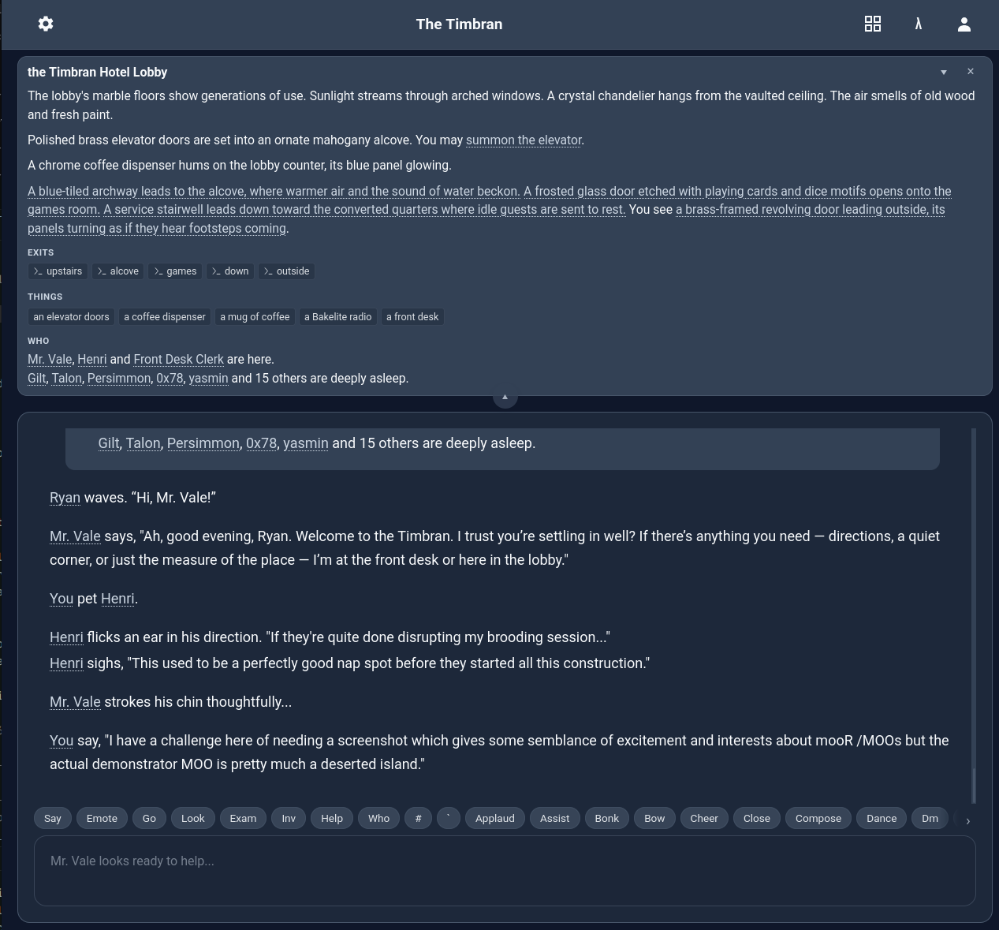
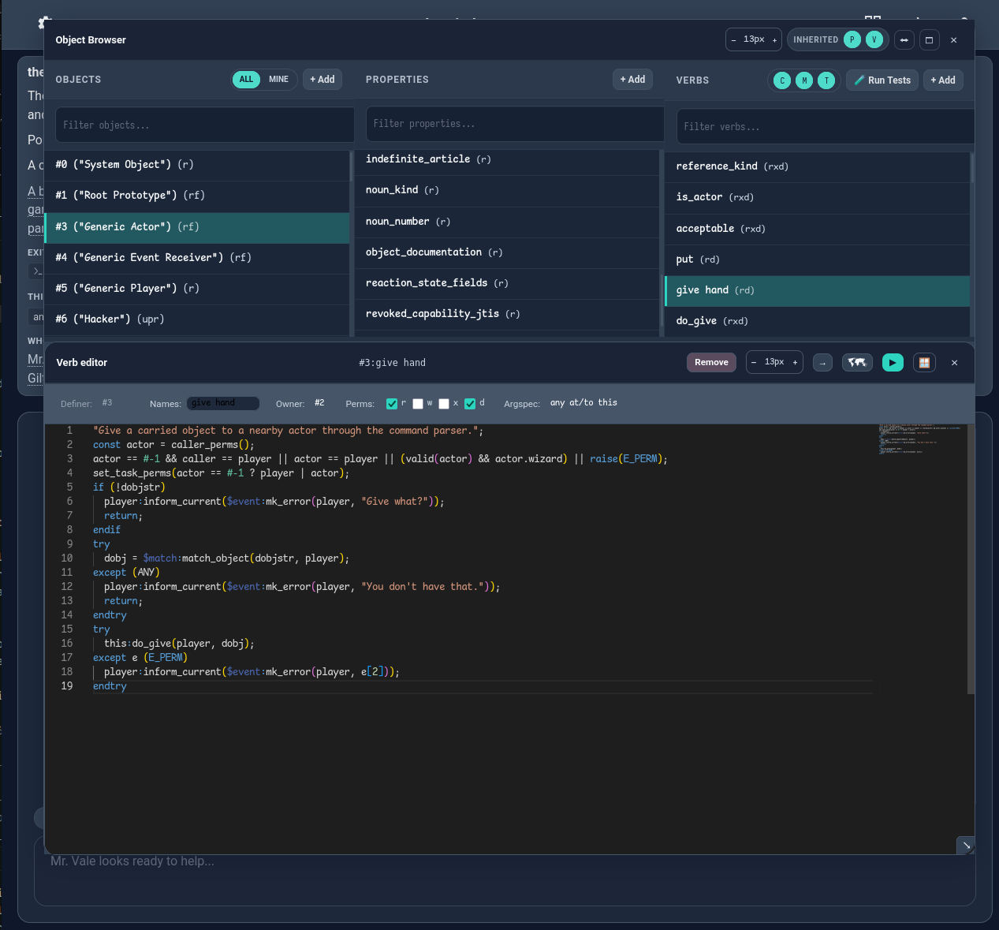
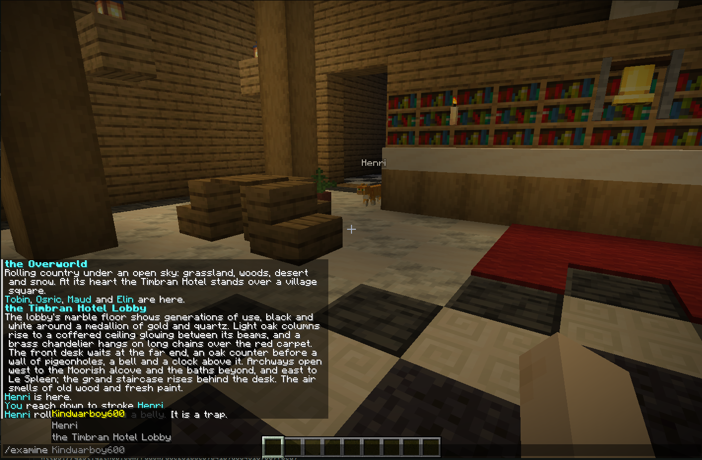

<p align="center"></p>

# mooR

[](https://discord.gg/Ec94y5983z)
[](https://timbran.org/book/2.0-dev/html/)
[](https://github.com/sponsors/rdaum)

**mooR is infrastructure for social worlds and games that people build and program together.**

A mooR world is shared and persistent. People meet in it, play in it, and shape it: they create
places and things, and program how those things behave, while the world is running and others are
using it. Nothing is rebuilt or redeployed. A change takes effect as soon as it is made, and the
world keeps everything between visits.

Many people can play, build and program at once without tripping over each other. Each action either
happens completely or not at all, so one person's half-finished change never breaks what someone
else is doing. The server uses every processor core of the machine it runs on.

Worlds can be textual or graphical. People connect through a friendly web interface or a classic MUD
client, and other ways in are added as "hosts", which translate a network protocol for the world.

The programs in a mooR world are written in MOO, a small language designed for this kind of world.
It comes from [LambdaMOO](https://en.wikipedia.org/wiki/LambdaMOO), one of the first online worlds
built by its own users (see [MOO](https://en.wikipedia.org/wiki/MOO)). mooR is a new server, written
from scratch, that extends the language and can import existing LambdaMOO databases. It has been in
development since 2022.

<table>
  <tr>
    <td></td>
    <td></td>
  </tr>
  <tr>
    <td align="center">Playing in the Timbran Hotel</td>
    <td align="center">Programming the same world from inside it</td>
  </tr>
</table>

## Built with mooR

<!-- TODO: an image per entry, and links where they are public. -->

- **[Cowbell](cores/cowbell/README.md)**: a starting world and object library for communities. It
  ships with this repository, and has a web-native interface through the Meadow client.
- **[Timbran Hotel](https://moo.timbran.org)**: a public community world running on Cowbell. Visit
  it to see mooR in use.
- **A Minecraft server (prototype)**: ordinary Minecraft clients connect to a mooR world. The world,
  its players and the game rules live in MOO, allowing many users to connect build and edit the same
  persistent world. (Currently private prototype and its source is not published at this time)

  

## Which version should I use?

Use the `v2.0-release` branch. mooR 2.0 is in code freeze, and a formal `2.0.0` release will follow
in the coming days or weeks. Cowbell, LambdaCore and the Meadow clients work against it. Please
report bugs against it.

2.0 has no release packages or container images yet, so build it from the branch as shown below. The
1.0 series is no longer supported. `main` is where development after 2.0 happens. See
[Branch policy](#branch-policy).

## Try it

You need Docker. Clone the 2.0 branch and start a world:

```bash
git clone -b v2.0-release https://github.com/timbran-project/moor.git
cd moor
./scripts/start-moor-cowbell.sh       # Cowbell, a modern starting world
./scripts/start-moor-lambdacore.sh    # or LambdaCore, the classic LambdaMOO core
```

Then open [http://localhost:8080](http://localhost:8080) in a browser, or point a MUD client at
`localhost`, port `8888`. Each core keeps its data in its own directory (`run-cowbell/`,
`run-lambda-moor/`).

The scripts build in release mode; pass `--debug` for a faster first compile. For other ways to run
mooR, including without Docker, see
[Docker Compose Setup](https://timbran.org/book/2.0-dev/html/the-system/docker-compose-setup.html)
and
[Alternative Installation Methods](https://timbran.org/book/2.0-dev/html/the-system/alternative-installation-methods.html)
in the book.

## What mooR gives you

**For people building worlds and games**

- Live programming/building: objects, verbs and commands change while the world runs, with no
  restart.
- Each action happens completely or not at all. When two people's actions collide, mooR runs one of
  them again, so neither sees the other's work half done.
- Coarse and fine-grained task permissions, and time and tick-based sandboxing; mooR is designed so
  that another person's contribute code shouldn't harm your experience or other's.
- A nice web client (Meadow) with an in-world code editor / IDE tools
- As well as support for classic MUD clients over "telnet".
- A fancy task scheduler.
- External "workers" that let MOO code reach outside the world over HTTP, Git and files, with
  wizard-controlled permissions.

**For programmers**

- The MOO programming language extended with UTF-8 strings, 64-bit integers, booleans, maps,
  symbols, binary values, lexically scoped variables, list comprehensions, and lambdas with closures
  (`{x, y} => x + y`), and more.
- Friendly import/export format, worlds as source: the `objdef` format exports a world to a
  directory of text files that work well with Git, and Cowbell's `@changes` reviews and applies
  changes from those files inside the world.
- Native verbs: compiled code called from MOO through a C ABI.
- An HTTP and WebSocket API for building clients, with an OpenAPI description.

**For running a server**

- Multithreaded. Every task is a transaction in a database with optimistic concurrency and snapshot
  isolation; conflicting tasks are retried. mooR scales out across cores to handle load on modern
  hardware.
- Flexible deployment options -- from a single `moor` server that does everything to a clustered
  deployment where "hosts" (network front ends) live in separate processes that can be
  load-balanced, sandboxed, etc.
- Container images and Debian packages (for 2.0, from the formal release).
- Extensive observability & telemetry: Metrics through e.g. prometheus to track what's going down on
  your server, and profiling (via eBPF-driven `mootop`) to see live which verbs and tasks use the
  server's CPU.

**For existing MOOs**

- Imports LambdaMOO 1.8.x databases, and some ToastStunt databases.
- Keeps LambdaMOO behaviour where MOO code depends on it, such as which tasks keep their changes.

## What's in this repository

| Directory                       | Contents                                                                                  |
| ------------------------------- | ----------------------------------------------------------------------------------------- |
| [`crates/`](crates/README.md)   | The server: compiler, VM, database, scheduler, RPC daemon, and the telnet and web "hosts" |
| [`cores/`](cores/)              | Worlds: [Cowbell](cores/cowbell/README.md), [Snore](cores/snore/README.md), LambdaCore    |
| [`clients/`](clients/README.md) | [Meadow](clients/meadow/README.md) web client, the Flutter client, the web SDK            |
| [`tools/`](tools/)              | `moorc` compiler, `mootop`, load testing and other tools                                  |
| [`deploy/`](deploy/README.md)   | Deployment examples: single process, clustered, Kubernetes, Debian packages               |
| [`book/`](book/)                | Source for the mooR Book                                                                  |

## Learn more

- [The mooR Book](https://timbran.org/book/2.0-dev/html/): the full documentation
- [The MOO programming language](https://timbran.org/book/2.0-dev/html/the-moo-programming-language.html)
- [Server architecture](https://timbran.org/book/2.0-dev/html/moor-architecture.html)
- [Running a server](https://timbran.org/book/2.0-dev/html/the-system/running-the-server.html) and
  the [deployment guide](deploy/README.md)
- [Discord](https://discord.gg/Ec94y5983z), for questions and discussion

## Contributing and bug reports

File bugs and feature requests on the
[issue tracker](https://github.com/timbran-project/moor/issues). Report bugs against `v2.0-release`,
and include the commit you are running, steps to reproduce, what you expected and what happened, and
any relevant logs.

To contribute code, cores or documentation, see [CONTRIBUTING.md](CONTRIBUTING.md).

## Supporting mooR

mooR is an independent project. I (Ryan Daum) started it in November 2022 and have written most of
its more than 4,500 commits, with help from other contributors. If you use it, or want it to keep
growing, please consider [sponsoring the project on GitHub](https://github.com/sponsors/rdaum).
Sponsorship pays for development time and for running the public Timbran Hotel world.

If your organization wants to build on mooR (or something like it!) I also offer consulting, support
and alternative licensing through Timbran Consulting. See [License](#license).

## Branch policy

- `v2.0-release`: the 2.0 release line, for bug fixes, stability work, and releases. Database
  formats, network APIs and MOO language behaviour are frozen.
- `main`: `2.1.0-dev`, development after 2.0. Changes there stay cautious for now.
- Bug fixes land on `main` first, then are cherry-picked to `v2.0-release` when safe.
- Release tags, packages, and published images for 2.0 are cut from `v2.0-release`.
- `v1.0-release` and the `1.0.x` releases are no longer supported.

Development moved from Codeberg to
[github.com/timbran-project/moor](https://github.com/timbran-project/moor) in July 2026
([why](https://timbran.org/catching-up-with-moor.html#we-moved-back-to-github)). Codeberg keeps the
earlier history, and GitHub hosts the `1.0.0` to `1.0.2` releases.

## License

mooR is licensed under the GNU Affero General Public License v3.0. See [LICENSE](./LICENSE) for
details.

mooR is intended to be run as a networked multi-user system, not only as a local program. For that
reason, the project uses the AGPL rather than the GPL: if someone modifies mooR and runs that
modified version as a service, the corresponding source for those modifications should remain
available under the same terms.

Running your own database, world, MUD, or MOO on top of mooR does not transfer ownership of that
database or its contents to the mooR project or its author. The relevant copyleft obligation is
about modifications to mooR itself, or reuse of mooR code in another project, not about ownership of
the world data or creative content you host with it.

This applies to the main mooR software in this repository. Documentation in `book/`, core database
content in `cores/`, and separately published client and schema libraries in `clients/` and
`crates/schema/schema/` have separate licensing terms; see those directories for details. The
`moor-native-verb` crate, with its C header, is licensed under the GNU Lesser General Public
License, version 3 or later, and [NATIVE-VERB-EXCEPTION.md](./NATIVE-VERB-EXCEPTION.md) lets native
verb libraries that use only it carry licenses of their own.

If your intended use of mooR requires different licensing terms, contact Ryan Daum, operating as
Timbran Consulting. Alternative licensing arrangements may be possible on a case-by-case basis.

Contributions are accepted subject to the contributor license agreement in [CLA.md](./CLA.md). The
CLA does not change the project's open source license; it is there so contributions can be included
in mooR while still allowing case-by-case alternative licensing arrangements where agreed. See
[CONTRIBUTING.md](./CONTRIBUTING.md) for details.
